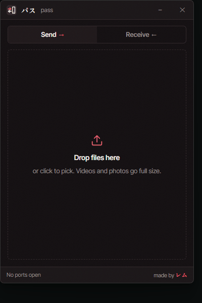
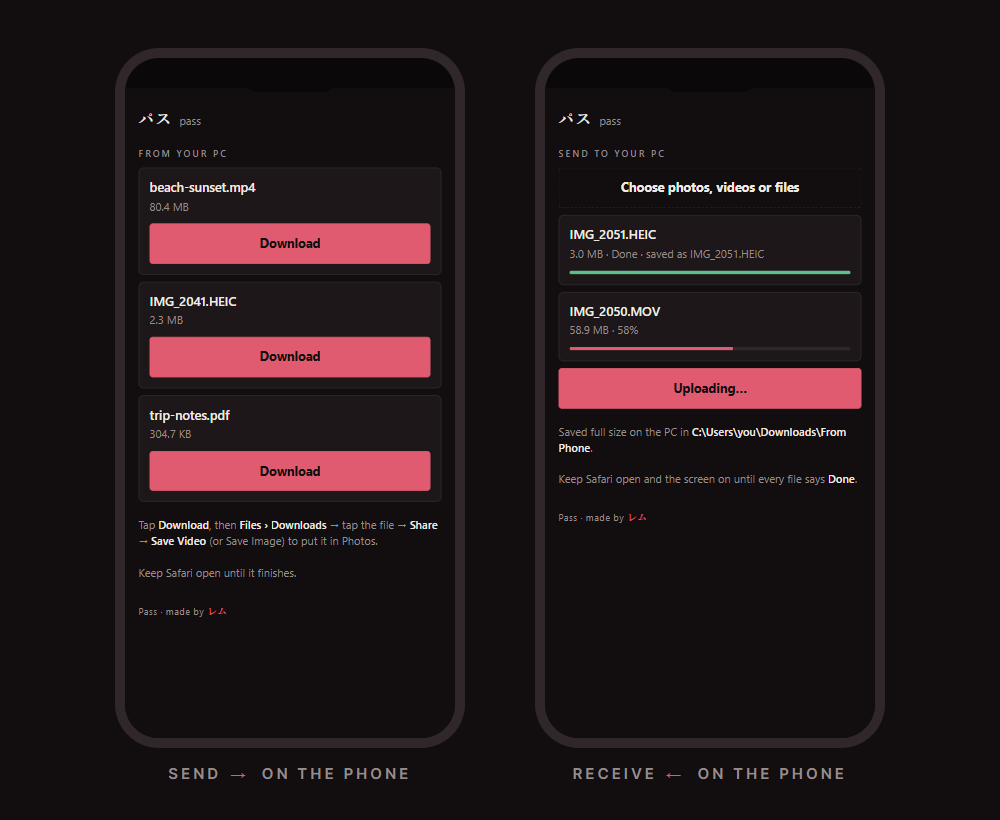
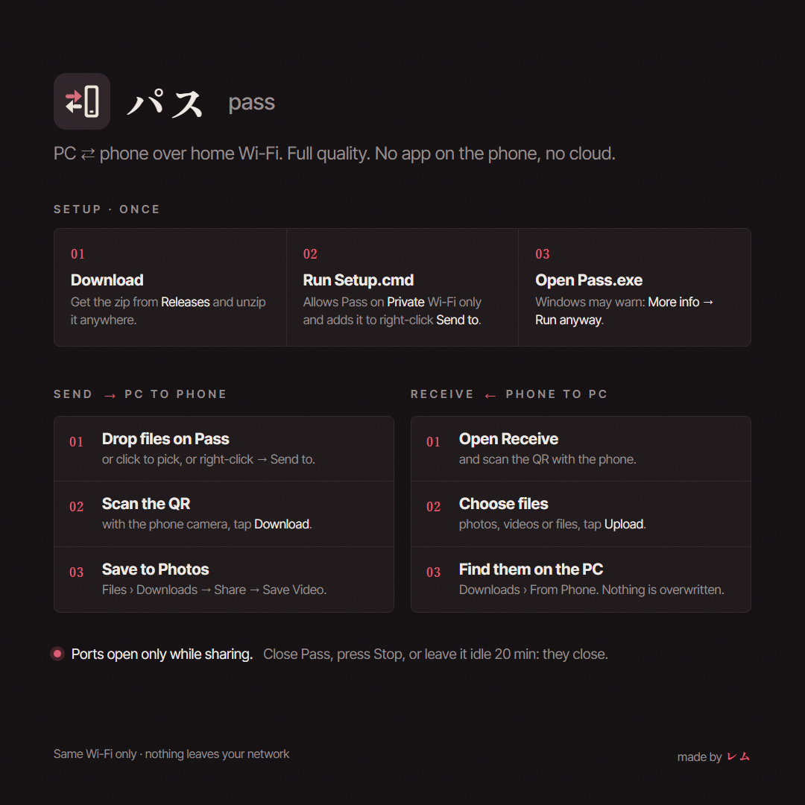

# パス Pass

Move files between your Windows PC and your phone over home Wi-Fi with a QR code. Both ways. No app on the phone, no cloud, no account, no compression: files arrive byte for byte.

<p align="center"></p>

<p align="center"></p>

## How to use



## Get it
Download `Pass-windows.zip` from [Releases](../../releases). **Unzip it to a folder you'll keep** (for example `Documents\Pass`), run `Setup.cmd` once, then open `Pass.exe`. Moved the folder later? Run `Setup.cmd` again.

Pass isn't code-signed, so Windows SmartScreen may say "Windows protected your PC". Click **More info → Run anyway**. Prefer to check first? Read `pass_app.py` and build it yourself (below).

## Use

**Send (PC → phone)**
1. Drop files on the window (or click to pick, or right-click files → Send to → **Pass to phone**).
2. Scan the QR with the phone camera and tap **Download**.
3. iPhone: **Files › Downloads** → tap the file → **Share** → **Save Video** / **Save Image** to put it in Photos.
   Android: it's in **Downloads** (Files app, or the Downloads album in Gallery / Google Photos).

**Receive (phone → PC)**
1. Switch to **Receive** and scan the QR.
2. Tap **Choose photos, videos or files**, pick them, tap **Upload**.
3. Files land in **Downloads › From Phone** (**Open folder** jumps there). Same names get ` (1)`, ` (2)` added; nothing is overwritten.

Keep the browser tab open and the screen on until a transfer finishes (an interrupted download resumes). Works with iPhone (Safari) and Android (Chrome); the phone page shows the right tips for each.

Scanning: iPhone and most Android cameras read QR codes directly; otherwise use Google Lens or a QR app.

Picking from the iPhone Photos picker can turn HEIC into JPG. For the untouched original, pick through **Files**, or set Settings › Camera › Formats to **Most Compatible**.

## Ports and safety
- **Ports are open only while you share.** Send and Receive each open one port (from 3000 up) and the footer shows which. **Closing Pass closes them all**, and so do **Stop** and 20 minutes with no transfers.
- Only your home network: nothing goes through the internet. `Setup.cmd` allows Pass on **Private** networks only, never Public.
- Every share gets a random link; anything else gets a 404.
- Send serves only the files you picked. Receive writes only into its one folder, with cleaned file names, and never overwrites.

## Setup details
- `Setup.cmd` (asks for admin once): adds a Windows Firewall rule "Pass" (inbound TCP, Private only) and the right-click Send to entry. Safe to run again.
- `Add to Send to.cmd` adds only the Send to entry. To remove it, delete `Pass to phone` from `shell:sendto`.
- Remove the firewall rule: `netsh advfirewall firewall delete rule name="Pass"` (admin).
- PC and phone must be on the same Wi-Fi (not guest Wi-Fi).

## Troubleshooting
The **Help** link in Pass (bottom of the window and of the phone page) opens this section.

**The phone can't open the page, or it keeps loading**
- PC and phone must be on the **same Wi-Fi**. Guest networks usually block devices from seeing each other.
- Run `Setup.cmd` (it allows Pass through Windows Firewall). Then check Windows Settings › Network & internet › your Wi-Fi: **Network profile type** must be **Private**. Pass is never allowed on Public networks.
- Turn off a VPN on the PC or the phone.
- Some routers have "AP isolation" / "client isolation" turned on, which stops devices on the same Wi-Fi from talking to each other. Turn it off in the router settings, or try another network.
- If the link starts with something odd (like 172.x or 192.168.56.x), Pass picked a virtual network adapter (VPN, Hyper-V, VirtualBox, WSL). Disable that adapter or the VPN and reopen Pass.

**The QR code won't scan**
Use the normal camera app, or Google Lens on Android. You can also type the link shown next to the QR into the phone's browser.

**Windows says "Windows protected your PC"**
Pass isn't code-signed. Click **More info → Run anyway**. You can read the code here and build it yourself instead.

**A download or upload stops halfway**
Keep the browser tab open and the screen on until it finishes. If a download stops, resume it from the browser's downloads list or tap Download again; a failed upload shows **Retry failed**.

**iPhone photos arrive as JPG instead of HEIC**
The Photos picker converts them. Pick through **Files**, or set Settings › Camera › Formats to **Most Compatible**.

**Where are the received files?**
**Downloads › From Phone** on the PC. **Open folder** in the Receive tab goes there.

**"Pass to phone" is gone from Send to, or Windows asks about the firewall again**
You moved or renamed the Pass folder. Run `Setup.cmd` again from the new spot.

**It stopped sharing by itself**
After 20 minutes with no transfers, Pass closes its ports. Add the files again (Send) or press **Start receiving** (Receive) for a new QR.

**Uninstall**
Delete the Pass folder, delete `Pass to phone` from `shell:sendto`, and remove the firewall rule (admin): `netsh advfirewall firewall delete rule name="Pass"`.

**Still stuck?** [Open an issue](https://github.com/Remmychii/Pass/issues) and say what you tried. Please don't post your full link or QR.

## Build from source
Windows, Python 3.12:
```
pip install pywebview segno pyinstaller
build.cmd
```
`python pass_app.py` runs it without building. `python pass_app.py --no-gui <file>` or `--no-gui --receive [folder]` runs headless and prints the link. `release.cmd` builds and zips a release.

## Credits
Made by **レム** (Rem) · [github.com/Remmychii](https://github.com/Remmychii)

Built with AI assistance (Claude), designed, tested and maintained by レム.

MIT license. Fonts: [Inter Tight](https://github.com/rsms/inter-tight) and [Zen Old Mincho](https://github.com/googlefonts/zen-oldmincho), SIL Open Font License 1.1.
